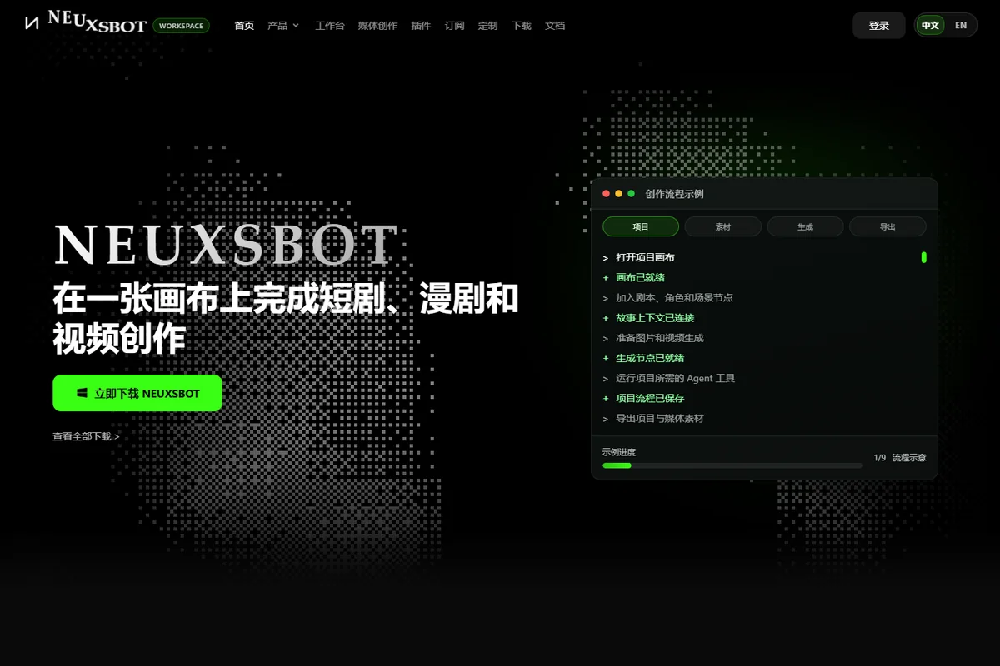
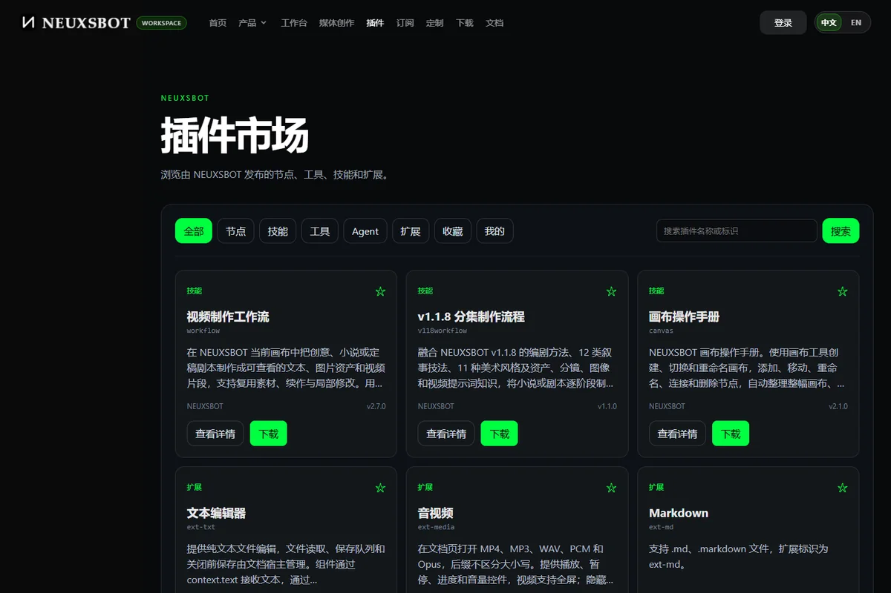
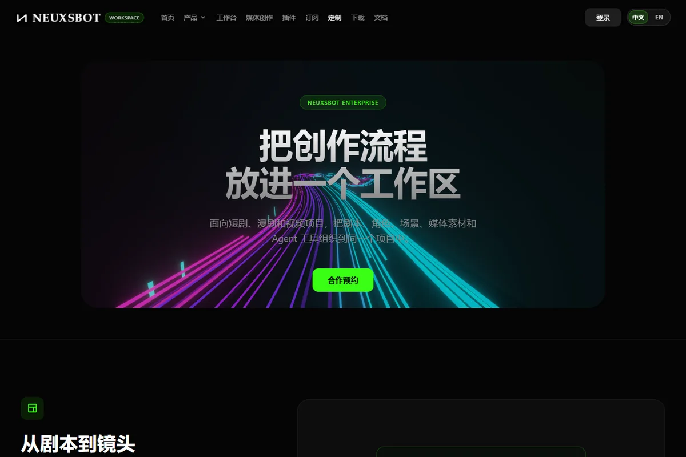

# NEUXSBOT | AI Creative Workbench

简体中文：[README.md](README.md)

NEUXSBOT is an AI creative workbench for short-form drama, manga-style video, animation, and visual storytelling. It brings story development, script writing, character and scene planning, storyboards, and image and video production into one visual project workspace. Creators can organize ideas, build production steps, and keep related media together as a project grows.

## Product Preview

## Creative Capabilities

- **Projects and visual canvas**: Organize text, images, video, and audio in projects, inspect how assets relate, and arrange creative steps in a visual workflow.
- **Writing and model conversations**: Connect compatible language-model services to support ideation, character profiles, story outlines, script revisions, and dialogue polishing.
- **Image and video production**: Connect configured image and video models, create visual assets, and bring results back into projects for further arrangement.
- **Nodes, plugins, and automation**: Extend workflows with nodes, tools, plugins, Agents, and MCP integrations, and organize repeatable steps into reusable processes.
- **Desktop and mobile clients**: Available for Windows x64, macOS Apple silicon, macOS Intel, and Android ARM64.

The desktop app and web client provide access to the same NEUXSBOT workbench and membership service. Local projects, canvas content, and workflows organize the creative process. Text, image, and video models are selected through configured providers; model availability, access, and pricing depend on each provider's configuration.

## Use Cases

Use NEUXSBOT for AI short-drama production, manga and motion-comic creation, novel adaptation support, script and dialogue development, character design, scene planning, storyboarding, AI image generation, AI video workflows, and visual content-workflow management for individual creators or teams.

Models are provided by services configured by the user. Model availability, account requirements, network access, and usage costs depend on the selected provider and its current configuration. Check the provider's terms and pricing before use.

## Downloads and Installation

Visit the [latest NEUXSBOT release](https://github.com/Neuxsbot/neuxsbot-build/releases/latest) and choose the package for your device:

- Windows 64-bit: `neuxsbot-X.Y.Z-Setup.exe`, the complete standalone installer.
- macOS Apple silicon: DMG with `arm64` in its filename.
- macOS Intel: DMG with `x64` in its filename.
- Android ARM64: `neuxsbot-X.Y.Z-android-arm64.apk`.

On Windows, run the versioned standalone installer; do not run the small bootstrapper inside `win-x64-neuxsbot-Setup.zip` by itself. On macOS, move the app to Applications. On Android, open the APK and follow the system installation prompt. See each release for version requirements and changes.

Whether a macOS package is signed and notarized with an Apple Developer ID depends on that build's configuration. Unsigned builds may show a security prompt on first launch. Download installers from the official NEUXSBOT release page.

## Search Keywords

NEUXSBOT, AI creative workbench, AI creation software, AI short drama production, short-form drama, manga video creation, motion comics, AI animation workflow, novel adaptation, AI script writing, screenplay writing software, storyboard software, character design, scene planning, AI image generation, AI video generation, visual canvas, node-based workflow, AI Agent, MCP plugins, Windows AI creative app, Mac creative software, Android AI creation app.
