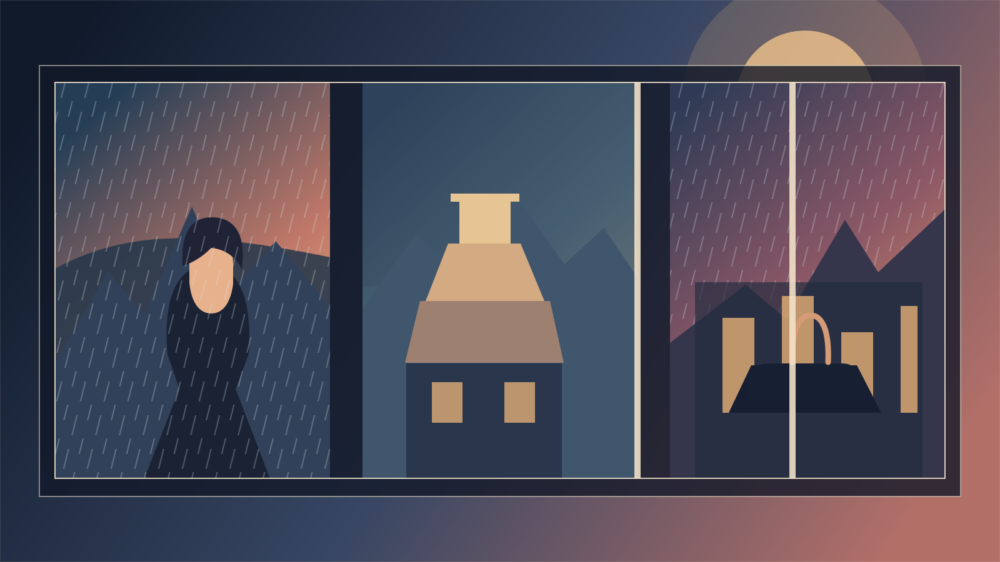

# NEUXSBOT | AI 创作工作台

英文版：[README.en.md](README.en.md)

NEUXSBOT 是为短剧、漫剧、动画短片和视频内容创作者打造的 AI 创作工作台。它把故事构思、剧本开发、角色与场景设定、分镜规划，以及图片和视频素材制作放进同一个可视化项目空间，让创作者从创意整理逐步推进到可复用的制作流程。

## AI 图像创作灵感

从角色概念、场景氛围到连续分镜，把文字想法发展成可继续编辑的视觉素材。

## 创作能力

- **项目与视觉画布**：在项目中整理文本、图片、视频和音频内容；通过画布查看素材之间的关系，并按创作步骤搭建工作流。
- **文本创作与对话**：连接兼容的文本模型，辅助灵感发散、人物设定、故事大纲、剧本修改和内容润色。
- **图像与视频制作**：连接已配置的图像、视频模型，生成或处理视觉素材，并将结果放回项目中继续编排。
- **节点、插件与自动化**：使用节点、工具、插件、Agent 和 MCP 扩展工作流，把重复步骤组织成可复用的创作流程。
- **桌面与移动客户端**：支持 Windows x64、macOS Apple 芯片、macOS Intel，以及 Android ARM64。

桌面端与网页版围绕同一套 NEUXSBOT 工作台和会员服务提供入口；本地项目、画布内容和工作流用于组织创作过程。通过已配置的服务商选择文本、图像或视频模型，模型清单、调用权限与费用由对应服务配置决定。

## 适用场景

NEUXSBOT 可用于 AI 短剧制作、AI 漫剧和动态漫画创作、小说改编辅助、剧本与对白开发、角色设计、场景概念整理、分镜规划、AI 图片生成、AI 视频制作，以及团队或个人的可视化内容工作流管理。

模型由用户配置的服务提供。可用模型、账号要求、网络可用性和调用费用取决于所选服务商及其当前配置；使用前请确认服务商的条款与价格。

## 下载与安装

前往 [NEUXSBOT 最新版本](https://github.com/Neuxsbot/neuxsbot-build/releases/latest)，按设备选择：

- Windows 64 位：`neuxsbot-X.Y.Z-Setup.exe`，完整单文件安装器。
- macOS Apple 芯片：文件名含 `arm64` 的 DMG。
- macOS Intel：文件名含 `x64` 的 DMG。
- Android ARM64：`neuxsbot-X.Y.Z-android-arm64.apk`。

Windows 直接运行版本化的完整安装器；不要单独运行 `win-x64-neuxsbot-Setup.zip` 内的小型启动器。macOS 将应用拖入“应用程序”；Android 打开 APK 并按系统提示安装。具体版本要求和更新内容见对应发布说明。

macOS 安装包是否经过 Apple Developer ID 签名与公证，取决于该版本的构建配置。未签名版本首次打开时，macOS 可能显示安全提示；请从 NEUXSBOT 官方发布页获取安装包。

## 搜索关键词

NEUXSBOT、纽斯博特、AI 创作工作台、AI 创作软件、AI 短剧制作、AI 短剧创作、AI 漫剧制作、动态漫画制作、AI 视频创作软件、AI 视频生成工作流、AI 图片生成、AI 生图工具、小说改编、剧本创作软件、AI 剧本创作、分镜设计、分镜脚本、角色设定、场景设计、视觉画布、节点式工作流、AI Agent、MCP 插件、Windows AI 创作软件、Mac AI 创作软件、Android AI 创作应用。
